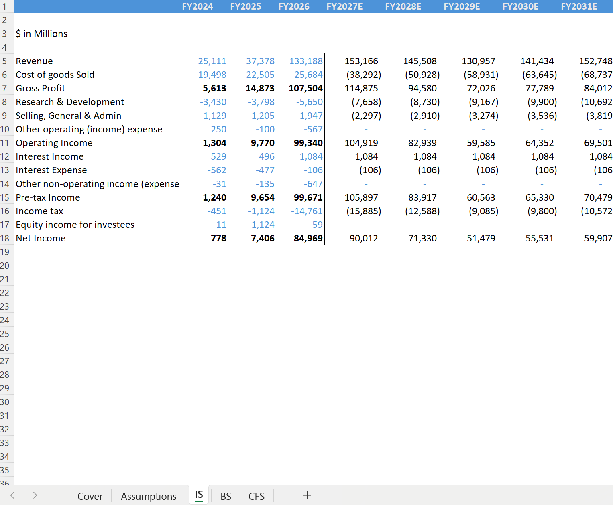
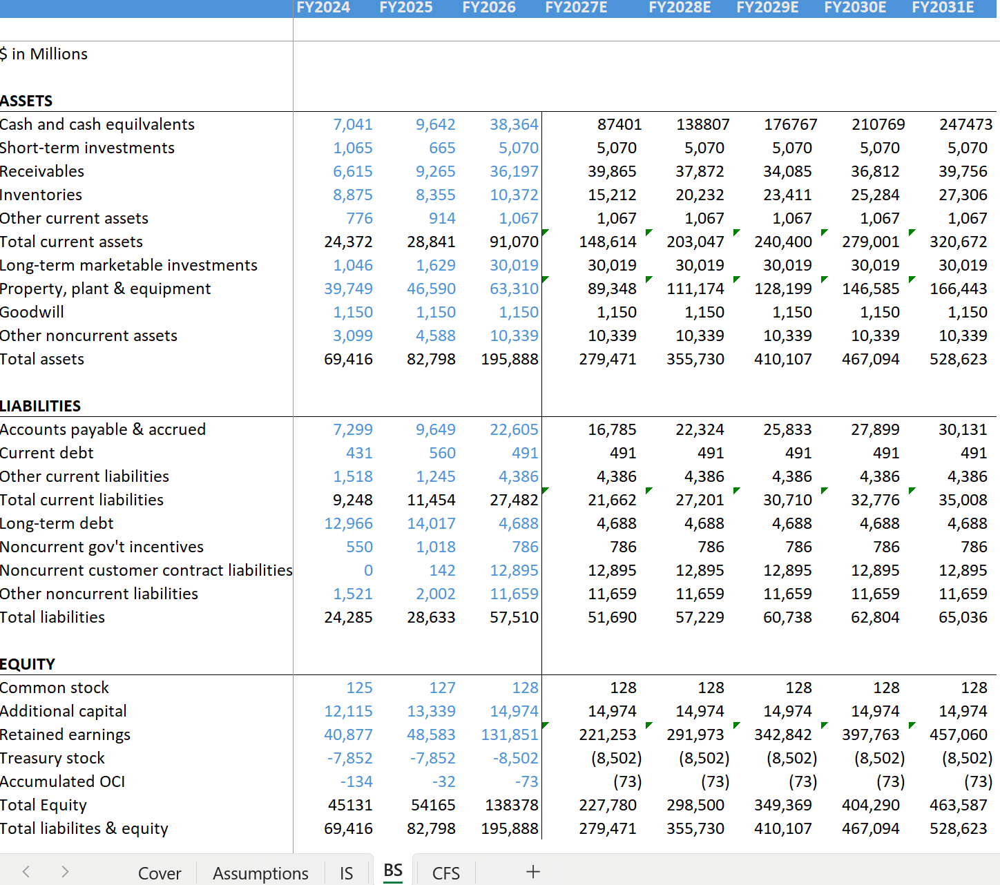
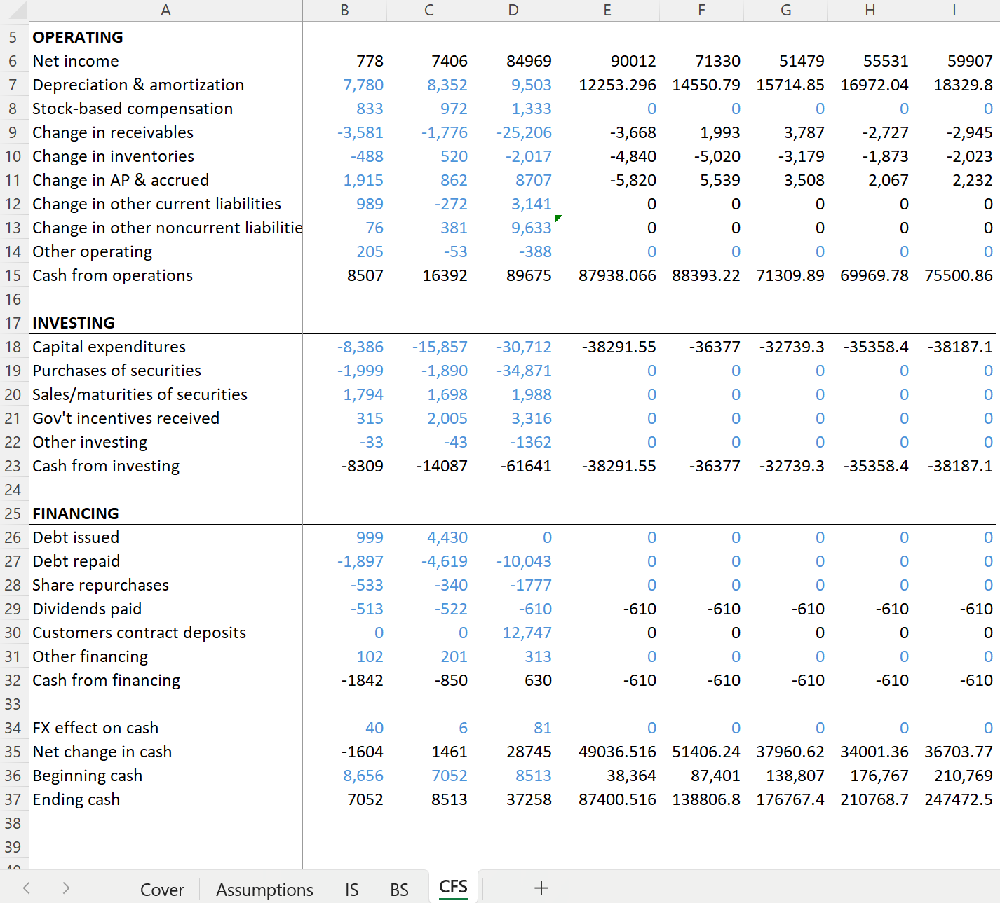
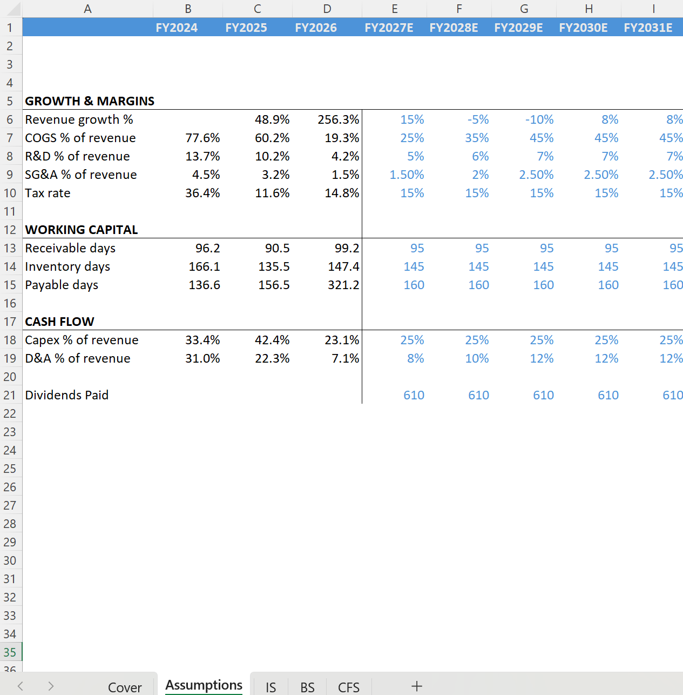

# Micron Technology (MU) – Three-Statement Financial Model

A fully linked three-statement financial model of **Micron Technology** built in Excel, using three years of historical data from Micron's SEC 10-K filings and a five-year driver-based forecast (FY2027–FY2031).


---

## What's inside

| Tab | What it does |
|---|---|
| **Cover** | One-page summary: key metrics, revenue vs. net income chart, and takeaways |
| **Assumptions** | Historical ratios (FY2024–FY2026) and forecast inputs (FY2027E–FY2031E) |
| **IS** | Income statement – history from the 10-K, forecast driven by assumptions |
| **BS** | Balance sheet – includes a balance check that equals zero in every year |
| **CFS** | Cash flow statement – calculates ending cash, which flows back to the balance sheet |

All figures are in **$ millions**. Blue font = hard-coded inputs, black font = formulas.

---

## How the model is linked

```
Assumptions ──► Income Statement ──► Net Income
                                        │
                                        ▼
Balance Sheet ◄── Ending Cash ◄── Cash Flow Statement
      │
      ▼
Balance Check = Total Assets − (Liabilities + Equity) = 0
```

- **Net income** from the income statement is the starting line of the cash flow statement.
- **Changes in working capital** (receivables, inventory, payables) come from the balance sheet.
- **Ending cash** from the cash flow statement becomes cash on the balance sheet.
- **Retained earnings** grow by net income minus dividends.
- **PP&E** grows by capex minus depreciation & amortization.

---

## Historical highlights (FY2024–FY2026)

| | FY2024 | FY2025 | FY2026 |
|---|---|---|---|
| Revenue | 25,111 | 37,378 | 133,188 |
| Revenue growth | — | 48.9% | 256.3% |
| Gross margin | 22.4% | 39.8% | 80.7% |
| Operating margin | 5.2% | 26.1% | 74.6% |
| Net income | 778 | 8,539 | 84,969 |

FY2026 was an extraordinary year: revenue more than tripled on AI-driven memory demand, while cost of goods sold barely moved, pushing margins to record highs.

---

## Key forecast assumptions (base case)

| Driver | FY2027E | FY2028E | FY2029E | FY2030E | FY2031E |
|---|---|---|---|---|---|
| Revenue growth | 15% | -5% | -10% | 8% | 8% |
| COGS % of revenue | 25% | 35% | 45% | 45% | 45% |
| R&D % of revenue | 5% | 6% | 7% | 7% | 7% |
| SG&A % of revenue | 1.5% | 2.0% | 2.5% | 2.5% | 2.5% |
| Tax rate | 15% | 15% | 15% | 15% | 15% |
| Receivable days | 95 | 95 | 95 | 95 | 95 |
| Inventory days | 145 | 145 | 145 | 145 | 145 |
| Payable days | 160 | 160 | 160 | 160 | 160 |
| Capex % of revenue | 25% | 25% | 25% | 25% | 25% |
| D&A % of revenue | 8% | 10% | 12% | 12% | 12% |

**The reasoning:** memory chips are a famously cyclical industry. The base case assumes the AI boom continues into FY2027, then cools in FY2028–29 as pricing normalizes, before returning to steady growth. Costs drift back toward mid-cycle levels, and depreciation rises as Micron's heavy factory investment comes online.

---

## Forecast results

| | FY2027E | FY2028E | FY2029E | FY2030E | FY2031E |
|---|---|---|---|---|---|
| Revenue | 153,166 | 145,508 | 130,957 | 141,434 | 152,748 |
| Operating income | 104,919 | 82,939 | 59,585 | 64,352 | 69,501 |
| Net income | 90,012 | 71,330 | 51,479 | 55,531 | 59,907 |
| Ending cash | 87,401 | 138,807 | 176,767 | 210,769 | 247,473 |

---

## Key takeaways

1. **FY2026 revenue grew 256%** on demand for AI memory, lifting margins to record highs.
2. **The base case assumes the memory cycle cools in FY2028–29** as pricing normalizes.
3. **Micron generates strong free cash flow** throughout the forecast while still funding heavy factory investment.

---

## Screenshots

| Income Statement | Balance Sheet |
|---|---|
|  |  |

| Cash Flow Statement | Assumptions |
|---|---|
|  |  |

---

## Simplifications

To keep the model clear and focused, a few items are held flat or set to zero in the forecast:
- Debt, short- and long-term investments, goodwill, and other assets/liabilities are held at FY2026 levels
- No share buybacks or new debt issuance; dividends held flat at $610M per year
- Interest income/expense held flat; stock-based compensation, other operating items, and FX effects set to zero
- Forecast beginning cash uses the balance sheet figure (the cash flow statement also includes ~$27M of restricted cash)

---

## Data sources

- Micron Technology [FY2026 Form 10-K](https://www.sec.gov/Archives/edgar/data/0000723125/000072312526000023/mu-20260903.htm) (SEC EDGAR)
- Micron Technology [FY2025 Form 10-K](https://www.sec.gov/Archives/edgar/data/723125/000072312525000028/mu-20250828.htm) (SEC EDGAR) – used for the FY2024 balance sheet

---

## Tools

Microsoft Excel – cross-sheet linking, driver-based forecasting, conditional formatting, charting

---

*Built by David Nazareth. Forecasts are illustrative assumptions for educational purposes, not investment advice.*
